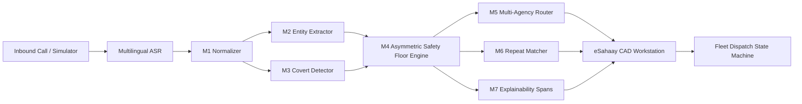

# 🛡️ eSahaay — AI-Powered Emergency Response & Multilingual Helpline Triage System

[](https://www.python.org/downloads/)
[](https://streamlit.io/)
[](#architecture)
[](#safety-guarantees)
[](LICENSE)

---

## 📌 Quick Copy-Paste for GitHub Repository Details

### 📝 Repository "About" Description (Short):
> **AI-Powered Emergency Response & CAD Triage Console for Multilingual Code-Mixed Hinglish calls. Features sub-3s triage, covert signal detection, asymmetric safety-floor fusion, and multi-agency dispatch.**

### 🏷️ Repository Topic Tags:
```
emergency-response, triage-system, hinglish-nlp, code-mixing, public-safety, computer-aided-dispatch, cad-workstation, streamlit, python, disaster-management, covert-detection, dispatch-engine, hackathon-project
```

---

## 🚨 The Problem

Emergency helplines across India (112, 181, 108) handle distress calls that are:
1. **Code-Mixed & Dialectal:** Callers mix Hindi, English, and local slang under panic (*"Bhaiya jaldi aao, bohot bleeding ho rahi hai"*).
2. **Fragmented & Covert:** Callers facing domestic threats speak in hushed whispers or feign ordering food/asking medical queries because a perpetrator is in the room.
3. **Time-Constrained:** Operators have approximately **10 seconds** to assess urgency, parse locations, identify threats, and route aid.
4. **Catastrophic Failure Modes:** Under-triaging a cardiac arrest, armed robbery, or violent assault has life-altering consequences.

---

## 💡 Solution: eSahaay

**eSahaay** is an intelligent, explainable Computer-Aided Dispatch (CAD) and Triage Co-Pilot designed to guarantee that **emergencies are never silently downgraded**. 

By uniting **probabilistic multilingual NLP reasoning** with a **deterministic safety rules floor**, eSahaay delivers an explainable, one-glance Triage & Dispatch Card to call-takers within seconds.

---

## ✨ Key Capabilities

- ⚡ **Sub-3s Hybrid Triage Pipeline (M1 — M7):**
  - **M1 Normalizer:** Script identification (Devanagari, Roman, mixed), phoneme-aware transliteration, and spelling-variant folding (`maar`/`mar`/`maara`).
  - **M2 Structured Extractor:** Extracts victim, perpetrator, weapons, injuries, ongoing status, and candidate landmarks.
  - **M3 Covert Signal Detector:** Recognizes disguised calls (grocery/pizza pretexts, coded doctor queries) and activates the safe contact protocol.
  - **M4 Asymmetric Urgency Engine:** Probabilistic NLP bounded by a deterministic safety rules floor ($P0 \ge P1 \ge P2 \ge P3$); emergencies can escalate but never silently downgrade.
  - **M5 Multi-Agency Router:** Priority-ranked vector routing across Police, Medical, Fire, Safe Shelter, and Legal Aid.
  - **M6 Repeat Complaint Matcher:** Privacy-preserving HMAC-SHA256 phone hashing, phonetic name matching, and spatial-temporal clustering.
  - **M7 Explainability Engine:** Visual evidence highlight spans directly linking urgency recommendations to the caller's spoken words.

- 🎙️ **Operator Phone Simulator:** Interactive audio ringing, realistic call playback, partial interim hypotheses vs committed final transcripts, and live call timer.
- 🗺️ **Delhi NCR Location Recovery:** Gazetteer matching across metro stations, colonies, and pincodes with confidence scoring and manual fallback.
- 🚑 **Fleet Dispatch State Machine:** Real-time unit tracking, Haversine road ETAs, and status lifecycle (`Available → Assigned → Dispatched → En Route → Arrived → Completed`).
- 🌓 **Dual-Theme CAD Workstation:** Toggle between **Dark CAD Command Console** (low-strain 24/7 command center) and **Clean Light Operations Console**.
- 📊 **Safety-First Evaluation Suite:** Automated 95% Bootstrap Confidence Intervals, severe under-triage tracking (<0.5%), and hidden-set evaluation.

---

## 🛠️ Architecture



---

## 🚀 Quickstart Guide

### 1. Clone the Repository
```bash
git clone https://github.com/YOUR_USERNAME/eSahaay.git
cd eSahaay
```

### 2. Install Dependencies
```bash
pip install -r requirements.txt
```

### 3. Launch the Application

**Option A — Windows One-Click Batch Launcher:**
```cmd
run_sahaay.bat
```

**Option B — PowerShell Launcher:**
```powershell
.\run_sahaay.ps1
```

**Option C — Standard Streamlit CLI:**
```bash
python scripts/seed_demo.py
python -m streamlit run app.py --server.port=8501
```

Open your browser to: **`http://localhost:8501`**

---

## 🔑 Demo Access Credentials

The database is pre-seeded with specialized persona accounts:

| Role | Email / Employee ID | Password | Access Capabilities |
|---|---|---|---|
| 🎧 **Operator** | `riya.sharma@sahaay.gov.in` (`OP1042`) | `operator123` | Live Call Triage, Phone Simulator, Location Recovery |
| 🛡️ **Supervisor** | `vikram.malhotra@sahaay.gov.in` (`SUP201`) | `super123` | Queue Overrides, Dispatch Approval, Repeat Unlink |
| 🚓 **Responder** | `rajesh.kumar@delhipolice.gov.in` (`RES305`) | `police123` | Field Unit Status, ETA telemetry, En Route updates |
| 📖 **Linguist** | `ananya.sen@sahaay.gov.in` (`LIN402`) | `linguist123` | Dialect Lexicon Editor, Covert Signal Approval |
| ⚙️ **Admin** | `pooja.verma@sahaay.gov.in` (`ADM901`) | `admin123` | SLA Configuration, Agency Thresholds, System Logs |
| 🏆 **Judge / Evaluator** | `judge@hackbvp.in` (`JUDGE01`) | `demo123` | Evaluation Benchmarks, Hidden Set Validation, SDG Board |

---

## 🧪 Automated Test Suite

Run the full automated test suite (48 test cases verifying safety floors, covert detection, repeat matching, transliteration, and dispatch):

```bash
python -m pytest
```

---

## 📁 Repository Structure

```text
eSahaay/
├── app.py                      # Core Streamlit CAD Workstation Entrypoint
├── sahaay/                     # Core Package
│   ├── auth.py                 # Multi-role authentication & password hashing
│   ├── models.py               # SQLAlchemy schema definitions
│   ├── database.py             # SQLite persistence engine
│   ├── triage/                 # M1-M7 Triage Pipeline
│   │   ├── pipeline.py         # End-to-end triage orchestrator
│   │   ├── normalizer.py       # Hinglish transliteration & folding
│   │   ├── covert.py           # Disguised pretext signal detection
│   │   ├── urgency.py          # Asymmetric rules floor engine
│   │   └── evidence.py         # Visual highlight generator
│   ├── dispatch/               # Dispatch state machine & fleet tracking
│   ├── repeat_matching/        # HMAC phone hashing & phonetic keys
│   ├── ui/                     # Design system, themes & components
│   └── evaluation/             # Bootstrap metrics & evaluation harness
├── config/                     # System Policies, SLAs & Lexicon rules
├── assets/                     # Clean vector branding & audio assets
├── scripts/
│   └── seed_demo.py            # Demo database seeder
├── tests/                      # 48 Unit & Integration test modules
├── run_sahaay.bat              # One-click Windows CMD launcher
├── run_sahaay.ps1              # One-click Windows PowerShell launcher
├── requirements.txt            # Python dependencies
└── Dockerfile                  # Containerized deployment spec
```

---

## ⚖️ License & Ethical Declaration

Built for **Hack@BVP 8.0**.  
All emergency calls, transcripts, responder fleet units, and audio clips used in this repository are **simulated synthetic demo data** designed to run offline on local developer workstations without real telephony dialers or personal identifiable information (PII).
